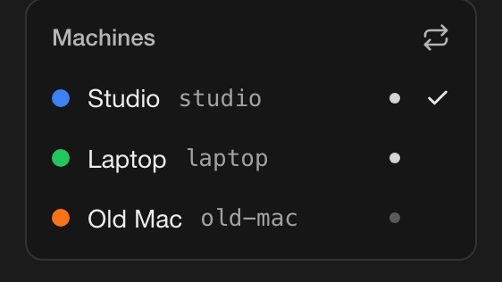
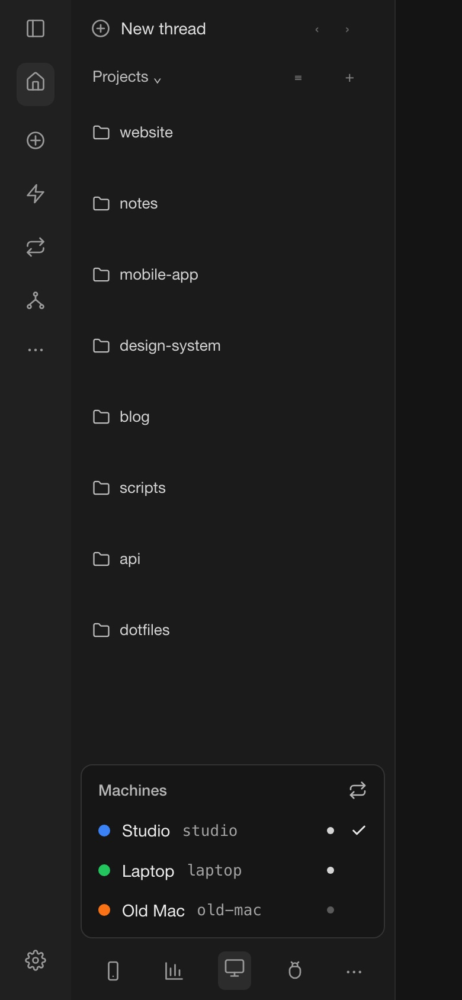
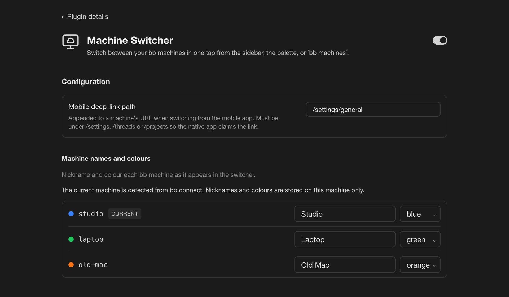

# Machine Switcher for bb

Switch between your bb machines in one tap. Desktop, browser, and phone.

If you run bb on more than one computer, you already know the dance: open settings, find the server list, pick one, wait. Machine Switcher puts every machine on your account one tap away, in the same spot on every device.

<p align="center">
  
</p>

## What you get

**A machine list in the sidebar footer.** Tap the monitor icon at the bottom of the sidebar and your machines appear. The one you are on has a check. Live machines have a bright dot, offline ones are dimmed. Tap another machine and you are there.

**Nicknames and colours.** Handles like `mbr-plexair` are fine for a server. They are not fine at a glance. Give each machine a name and a colour from the plugin's settings page or the command line, and the list reads like your machines, not your DNS.

**The same thing on your phone.** The list lives in the sidebar drawer on mobile too, with thumb-sized rows. Tapping a machine hands off to the bb app on that machine, so notifications and the native server picker follow along.

**A keyboard route.** `Mod+Alt+M` opens the list from anywhere, and "Machines: switch machine" is in the command palette.

**A command line.** `bb machines` lists your machines, and lets you set names and colours from a terminal or from an agent.

<p align="center">
  
</p>

## Install

Every machine installs the same way. Run this on each one:

```sh
bb plugin install git:https://github.com/micahbrich/bb-plugin-machine-hop.git@^0.1.0 --yes
```

Updates arrive as new tags. When one lands:

```sh
bb plugin update machine-switcher
```

Git installs build the plugin locally, which needs Node and npm on that machine's PATH.

## Name your machines

Open **Settings → Installed plugins → Machine Switcher**, or use the CLI:

```sh
bb machines list
bb machines label mbr "Plex Air"
bb machines color mbr blue
bb machines label mbr --clear
```

Colours are `red`, `orange`, `yellow`, `green`, `teal`, `blue`, `purple`, `pink`, or `none`. Names and colours are stored on the machine you set them on, so set them where you look most often.

<p align="center">
  
</p>

## How switching works on each device

Each client reaches another machine differently, and the plugin picks the right path for the one you are on.

| Where you are | What happens when you tap |
| --- | --- |
| **bb desktop app** | Asks the desktop app to switch servers natively, the same way its own Server menu does. |
| **A browser** | Navigates to that machine's `getbb.app` address. |
| **bb mobile app** | Opens the app's **This device** screen, where you tap **Servers** and pick the machine. |

On the desktop app, a machine has to appear in **bb → Desktop Settings → Server** before the plugin can select it. Signing that app in to bb Connect fills the list automatically. If you added a machine there by URL instead, the plugin matches it by address. Either way, if the desktop app has no entry for a machine the plugin says so instead of doing nothing.

Since bb iOS 0.39.0 the app sends any link to another machine to Safari, even one it would otherwise open itself, so the plugin can't switch for you in one tap any more. Older app versions still get one-tap switching through a link the app claims. That link ends in `/settings/general` by default. It has to stay under `/settings`, `/threads`, or `/projects` for the bb app to claim it. You can change the path on the settings page.

## Where the list comes from

The plugin asks bb Connect for every server on your account, so a new machine shows up as soon as it is signed in. Nothing about your machines leaves bb. Nicknames and colours are stored locally in the plugin's own storage.

## Develop

```sh
npm install
npm test
npx tsc --noEmit
bb plugin build
bb plugin install . --yes
```

`bb plugin dev` rebuilds and reloads on every save.

- `server.ts` lists machines through the builtin `connect` plugin, merges your nicknames and colours, exposes `machines_list` and `machines_set_override` over RPC, and registers the `bb machines` CLI.
- `app.tsx` registers the sidebar footer disclosure, the palette command, and the settings section.
- `lib/client-bridge.ts` decides how to switch on the current client.
- `lib/machine.ts` holds the types and constants both sides share. Frontend code must not import values from `server.ts`, because git installs build without dev dependencies and the server's SDK import would not resolve.
- `skills/machine-switcher/SKILL.md` tells agents the CLI exists.
- `docs/mockups/` holds HTML mockups of the screenshots, with made-up machines and projects. Edit them and run `docs/mockups/render.sh` to regenerate the images in `docs/`.

Releases are semver tags. Push a new `vX.Y.Z` for every change, never move an existing tag.
